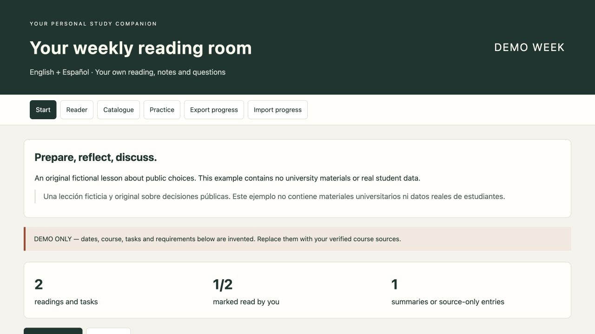
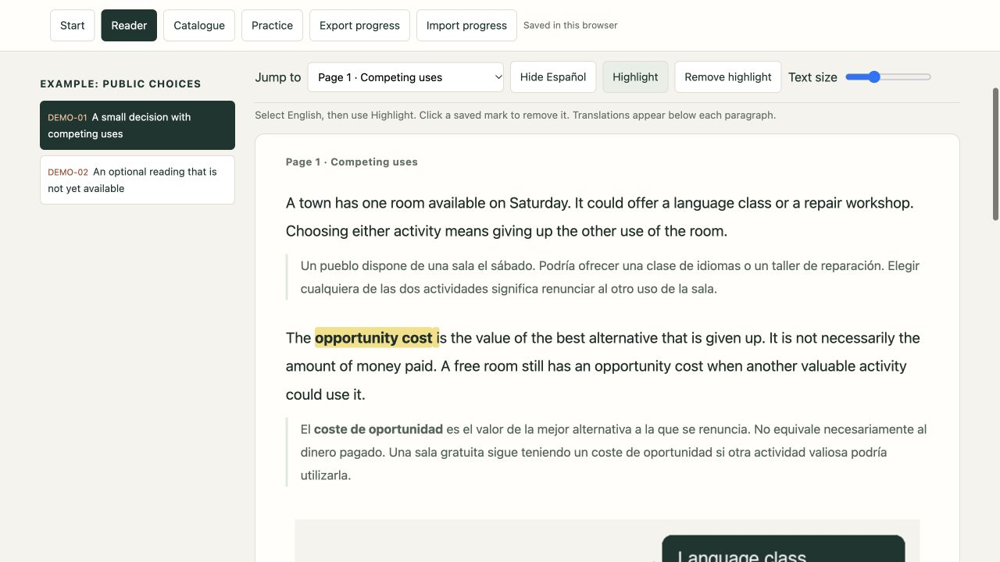
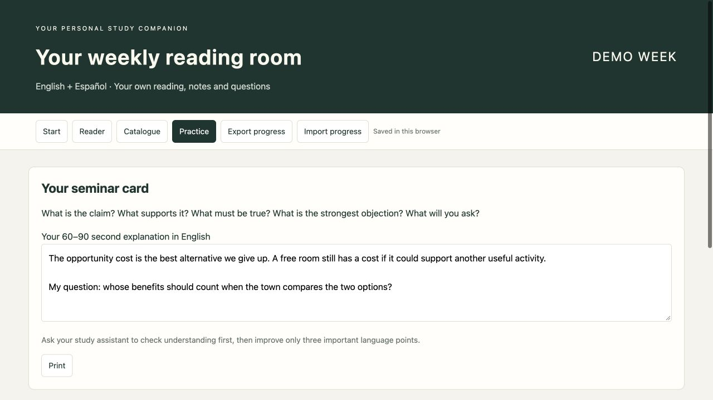
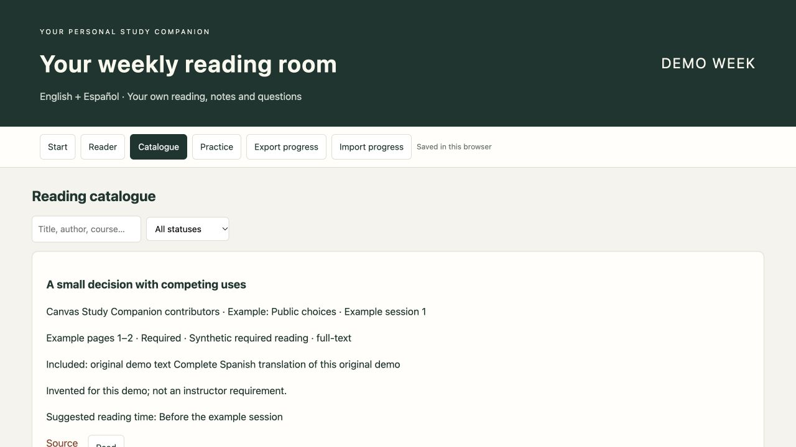

# Canvas Study Companion

A personal reading room for your university courses: English paragraphs followed by your chosen translation language, stable highlights, notes, reading progress, and a source-backed weekly plan.

**Copy this one sentence into an AI coding assistant that can read repositories, run local commands, and create files:**

> Read https://github.com/mashbean/canvas-study-companion/blob/main/START_HERE.md and follow this repository to build my own private Canvas study site, asking for my courses, timetable and preferred language, guiding me through secure API setup, and preparing my first weekly reading pack.

The assistant will ask for your own course links, timetable, groups, language and study preferences. You do not need to edit the code yourself. A chat-only assistant without file or network tools cannot perform the setup directly.

## What you get

- A weekly overview, reading catalogue, source links and preparation priorities.
- A continuous reader: one English paragraph, then its translation. Choose any language, including right-to-left scripts, or English only.
- A fixed highlight toolbar: no floating translation popup and no DOM rebuilding while you select text.
- Notes, reading position, completion marks, and progress export/import saved in your browser.
- A read-only Canvas collector with pagination, linked-page/attachment discovery, version hashes, source snapshots and explicit gaps.
- An AI-guided workflow for reviewing and translating material you are allowed to use. **The scripts do not translate automatically or call an AI service.**

The interface is in English; translation content and language direction are configurable. An assistant can also localize interface labels if requested.

## Screenshots

Actual screenshots of the running demo. Click an image to view it at full size. All readings and sample notes are fictional; Spanish is shown as one example of a preferred translation language.

| Weekly overview | Bilingual reading and highlights |
| --- | --- |
| [](docs/screenshots/01-weekly-overview.jpg) | [](docs/screenshots/02-bilingual-reader.jpg) |
| **English seminar practice** | **Reading catalogue** |
| [](docs/screenshots/03-seminar-practice.jpg) | [](docs/screenshots/04-reading-catalogue.jpg) |

## Try the synthetic demo

Requires Python 3.10+; Node.js 20+ is only needed for development tests.

```sh
git clone https://github.com/mashbean/canvas-study-companion.git
cd canvas-study-companion
python3 -m pip install -r requirements.txt
python3 scripts/build_reader.py examples/demo-pack.json --output site/demo
python3 scripts/serve.py --directory site --port 8765
```

Open **http://127.0.0.1:8765/demo/**. The demo uses original fictional text and a Spanish translation. No real Canvas account is needed. On Windows, use `py -3` if `python3` is not available.

## Personal setup

Follow [START_HERE.md](START_HERE.md), or ask your assistant to do so. Detailed instructions are in [API setup](docs/API_SETUP.md), [reader data format](docs/DATA_FORMAT.md), and [weekly workflow](docs/WEEKLY_WORKFLOW.md).

```text
Public template                         Private local material (gitignored)
scripts/   API collection + building     config/   Your preferences and week plans
templates/ HTML, CSS and browser JS      data/     Sources, snapshots, reviewed packs
examples/  Synthetic content only        site/     Generated personal website
docs/      Setup and working practices   OS store  Token outside the repository
tests/     Behaviour and safety checks
```

The collector writes evidence. Your assistant then checks dates, source instructions and permissions, prepares the reviewed bilingual pack, and builds the reader. A successful API call is not proof that every reading or translation is complete.

## Privacy and access

This public repository contains **only reusable code, instructions and synthetic examples**. Your course materials, translated readings, grades, notes, tokens and generated site belong in private local storage. They are excluded from Git by default. Do not enable public hosting for a personal study pack.

The generated reader has no API token, no analytics, and no network collection code. Serve it on loopback using the included server. Keep the same hostname and port to retain browser storage; export progress before switching devices or browser profiles.

The local server rejects foreign host/origin headers, cross-site browser requests, hidden files, directory listings and links outside the reader folder. It sends no-cache, no-referrer and anti-framing headers. Open a generated reader URL such as `/demo/`; the server root does not list your folders. This is a personal local tool, not an authenticated multi-user hosting service: other software or accounts on the same computer may still access localhost and unencrypted browser storage.

When contributing, use your GitHub `noreply` address if you do not want your email in public commit metadata. `.gitignore` protects excluded files, not author identities or material already committed to Git history.

Personal token availability depends on your institution. Manual tokens are for permitted personal development; a shared multi-user service requires institution-approved OAuth. Do not send your token to a classmate or paste it into chat. See [Canvas authentication documentation](https://developerdocs.instructure.com/services/canvas/oauth2/file.oauth).

This project is independent and is not endorsed by Oxford, Instructure, or any university. Course and publisher rights still apply. The MIT licence covers this template and its original demo, not third-party course content.

## Development

```sh
npm ci --ignore-scripts
python3 -m pip install -r requirements.txt
npm test
```

Tests cover token routing, pagination, retries, linked attachments, HTML sanitization, language modes, stable highlighting, source-change warnings, progress persistence, and export/import. GitHub Actions runs synthetic tests only; it never uses a real Canvas account.
